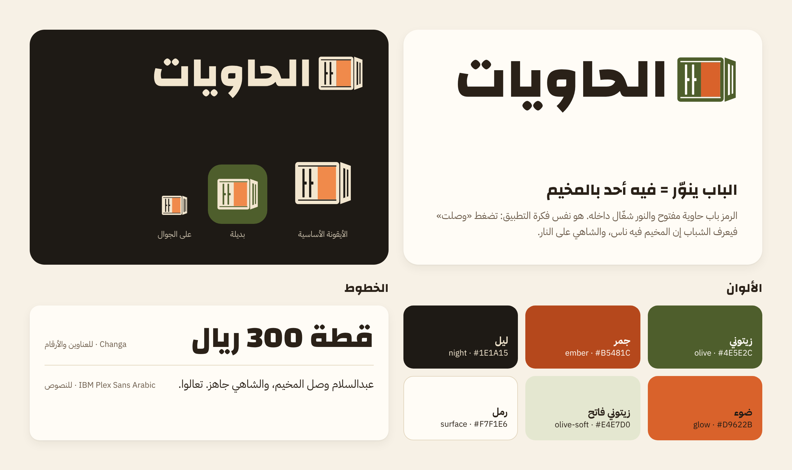

# الحاويات

تطبيق جوال خاص لمخيم «الحاويات»: القطة والمصاريف والحضور والعزايم، بدون إحراج.

## البداية من الجوال
1. افتح Claude Code من الجوال، واختر هذا المستودع (`hawyat`).
2. افتح ملف [`PROMPT.md`](PROMPT.md)، انسخ النص اللي فيه، والصقه في المحادثة.
3. Claude Code يشتغل مرحلة مرحلة. بعد كل مرحلة يفتح Pull Request ويقول لك كيف تجرّب من جوالك. جرّب، وادمج الطلب، وقل له «كمّل المرحلة اللي بعدها».

## محتويات المستودع
| المسار | وش فيه |
| --- | --- |
| `PROMPT.md` | البرومبت اللي تلصقه في Claude Code |
| `CLAUDE.md` | قواعد المشروع، يقراها Claude Code لحاله كل مرة |
| `docs/SPEC.md` | المواصفات الكاملة |
| `design/` | الهوية، الألوان، الثيم الجاهز للكود، وصور الشاشات التسع |
| `assets/` | الخطوط، الشعار، أيقونة التطبيق |

لو عدّلت فكرة أو أضفت ميزة، عدّل `docs/SPEC.md` أول، وبعدين قل لـ Claude Code يقراه.

> المستودع عام. لا تحط فيه أي كلمة مرور أو رابط قاعدة بيانات؛ مكانها متغيرات البيئة.

## تجربة التطبيق على الآيفون
التطبيق يُنشر تلقائيًا على EAS Update من GitHub Actions، وتفتحه في تطبيق **Expo Go**.

**مرة وحدة بس:**
1. نزّل **Expo Go** من App Store، وسجّل فيه بحساب expo.dev.
2. من متصفح الجوال: expo.dev ← سجّل حساب ← صورتك فوق ← **Access tokens** ← **Create token** ← انسخه.
3. في GitHub: المستودع ← **Settings** ← **Secrets and variables** ← **Actions** ← **New repository secret**. الاسم `EXPO_TOKEN` والقيمة التوكن.

**كل مرة:** افتح الـ Pull Request، وانتظر تعليق «EAS Update» (دقيقتين تقريبًا)، واضغط الرابط أو صوّر الـ QR بكاميرا الجوال. يفتح في Expo Go.
